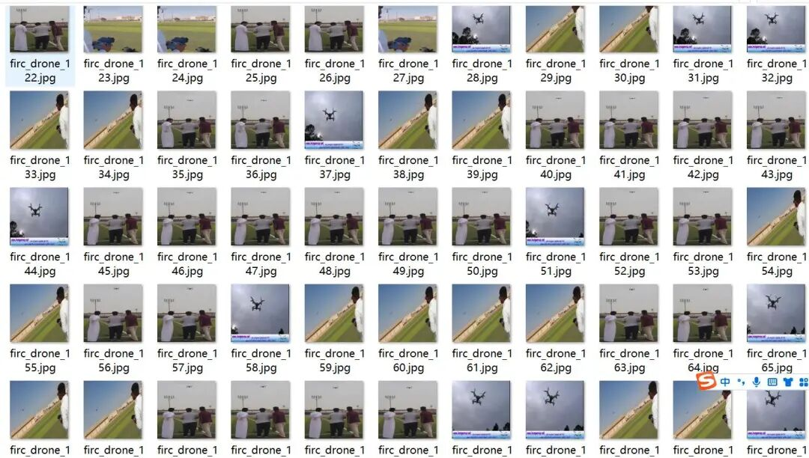
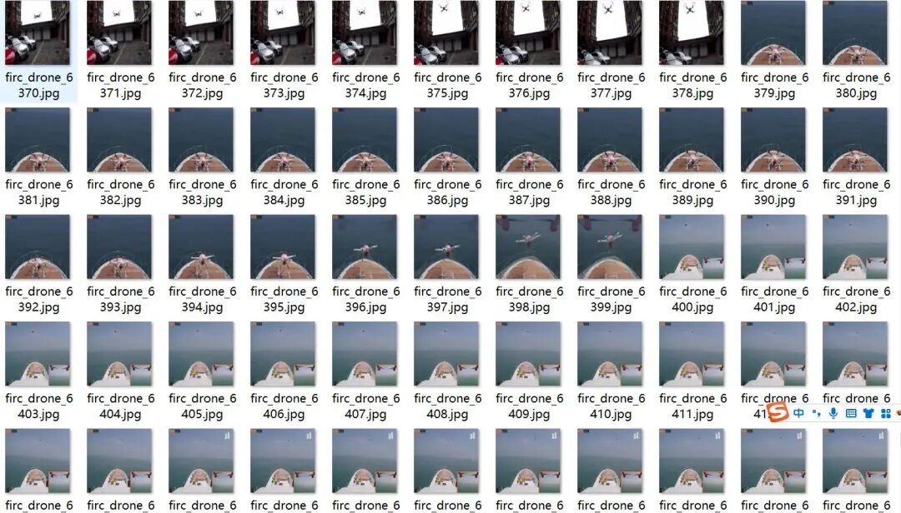
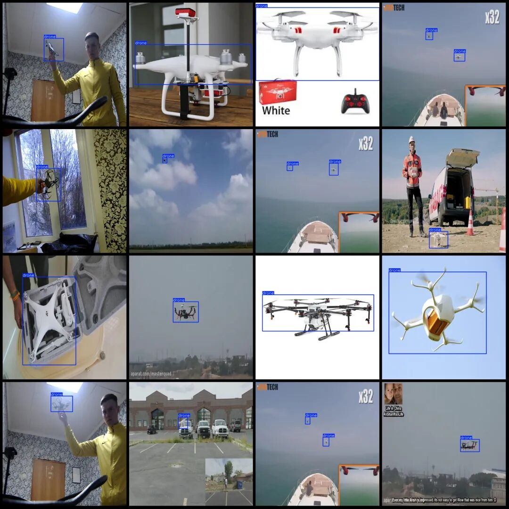

# Detection Dataset for Airborne Drones in VOC+YOLO format with 7261 images in one category

Dataset format: Pascal VOC format + YOLO format (txt file without split path, only containing jpg images and corresponding VOC format xml files and yolo format txt files)

Number of images (number of jpg files): 7261

Number of annotations (number of xml files): 7261

Number of annotations (number of txt files): 7261

Label category count: 1

Label category names (Note that the order of categories in the YOLO format does not correspond to this, but is based on the labels folder's classes.txt): ["drone"]

Number of boxes labeled in each category:

Drone frame count = 7831

Total frame count: 7831

Using labelImg:

Annotation rules: Draw a rectangle around the category.

Important Notice: No

Image resolution: 640x640

Special : This dataset does not guarantee the accuracy of the trained models or weight files.

Image Preview:

Annotation example (randomly select 6 images to show the annotation situation):

## Payment

Here is a pay link on Stripe ( https://buy.stripe.com/3cs8yP7sY87d0vu9AB ). Please contact me lonlonago@foxmail.com after funding $89, and I will send you a complete data files , thank you!

